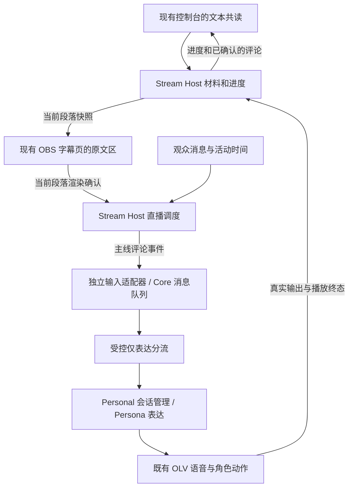

# 文本共读与角色评论功能计划书

- AG99live Stream Host · 2026-11-18 · 已实施
- 本版采用现有 AG99live Web 控制台管理共读，在现有 OBS 字幕页增加原文显示模式。共读材料、进度和调度由 Stream Host 管理。
- 原型阶段的验证记录见 [2026-11-18 验证记录](co-reading-validation.md)。

## 1. 目标与确定的边界

主播在现有控制台导入一篇文本。现有字幕页展示当前原文，桌宠在空闲时根据这段内容分享理解、评价或感慨。观众围绕当前内容聊天后，共读从原位置继续。

首版实现以下行为。

1. 原文由插件提供，AI 负责评论，不负责逐段朗读或续写原作。
2. 评论进入现有 Core 消息 Pipeline，明确选择仅表达路径，保留 Personal 会话管理和 Persona 表达能力。
3. 主线评论不进入普通任务执行器，不调用工具，也不经过随机主动话题的 Personal Policy 决策。
4. 语音、角色动作、流式输出和播放回执继续使用既有 OLV / AG99live 链路。
5. 原文展示和 AI 评论分别记录进度；播放完成不等于立即翻页。
6. 空闲时立即接收观众事件。忙碌时沿用直播输入的现有规则，礼物和上舰有限暂存，普通弹幕、醒目留言和进场事件丢弃。
7. 插件是材料与共读进度的唯一事实来源；AG99live 不新增阅读调度业务。

首版支持粘贴文本、导入 UTF-8 TXT / Markdown、分段预览、单篇共读、原文展示、角色评论、手动控制、自动翻页和进度恢复。

PDF / EPUB、联网找书、多作品排期、逐字高亮和动作反馈校准单独规划。

## 2. 当前源码基线与复用点

以 2026-11-18 本地源码为核对基线。直播主动话题改用 Runtime Observation，Core 已提交会话上下文和日常/直播调度改动。当前仍有独立的 Persona 流协议等工作，实施时从实际运行的版本核对涉及的调用链。

| 位置 | 已有能力 | 本功能的使用方式 |
| --- | --- | --- |
| Stream Host `main.py` | 生命周期、Runtime Observation Sensor、日常/直播主动话题绑定 | 将共读纳入同一目标的内容调度，协调随机话题 |
| Stream Host `stream_platform.py` | 独立输入适配器、表现目标绑定、忙碌判断、播放轮次等待 | 复用输入与输出身份绑定，补齐接收和终态结果 |
| Stream Host `bilibili_live.py` | 即时弹幕、小批合并、忙碌丢弃、最近观众活动时间 | 保留行为，向统一调度提供活动信息 |
| AstrBot `interaction/middleware.py` | Runtime Observation 纯表达、Persona 输出、普通 Pipeline 路由 | 复用表达实现；补齐受控的 Pipeline 仅表达契约 |
| AstrBot `interaction/personal_runtime.py` | 会话接收、轮次租约、生命周期 | 继续作为会话级并发和清理的所有者 |
| AstrBot `star/context.py` | 插件 Web API、插件实例查询、`SnapshotHub`、交互生命周期观察 | 复用管理 API 注册和进程内展示状态交换 |
| AG99live `frontend/src/web-control/ControlPanelApp.vue`、`web_control.py` | 现有管理导航、目标选择、插件视图 bridge 和带鉴权的接口 | 同一个控制台增加「文本共读」，复用目标选择和登录 |
| AG99live `transport/subtitle_web.py`、`views/subtitles` | 本机 OBS 浏览器源、静态资源和 SSE | 在同一个地址下按需显示当前原文和进度 |
| OLV `platform_adapter.py`、`runtime/turn_coordinator.py` | 外部输入轮次绑定、Core/播放 ID 关联、结束回执 | 继续负责表现，不复制一套播放管理 |

待开发的是材料和共读进度、受控的仅表达入口，以及从接收到播放的可关联结果。现有 Sensor 的公开校验已经确认会拒绝原文材料。`submit_live_item()` 当前提交普通直播消息，返回值也无法区分忙碌、静默与成功播放。

输入平台的 B 站监听改为按房间配置启用。未填写房间号时仍可向已配置的表现目标发起共读。填写无效房间号时返回配置错误。

## 3. 总体结构与所有权



- 插件维护原文、段落、展示版本、评论状态和翻页条件，不直接请求模型或合成语音。
- Core 在启动 Router / 执行器之前识别受控表达事件，不新增另一套表达模型和输出控制器。
- Personal 继续管理会话归属、并发接收、取消和资源释放，不让插件单独持有一把可绕过会话的锁。
- OLV 负责 Core/播放轮次绑定、增量输出及终态；Web 原文页不承担语音播放回执。
- 本功能不修改普通观众消息的执行路由；仅主线评论强制不进入执行器。

## 4. 用户流程和操作语义

### 4.1 开始一篇共读

1. 主播打开现有 AG99live Web 控制台的「文本共读」，选择已与 Stream Host 绑定的表现目标，粘贴或导入文本，填写标题。
2. 插件按自然段和句子边界分段。主播预览、合并或拆分，保存后建立待开始的场次。
3. 主播预览原文，通过控制台复制共读模式地址，在已有 OBS 浏览器源中启用原文区。首个确认已渲染的浏览器持有展示回执，断线或超时后其他已打开此地址的浏览器可以接手。
4. 点击“开始”，展示当前段落；收到该展示版本的渲染确认后，开始计算停留时间。
5. 短暂留出观众输入机会。目标空闲时提交本段评论，随后按翻页规则继续。

### 4.2 管理操作

| 操作 | 行为 |
| --- | --- |
| 暂停 | 停止新评论和自动翻页；当前发言自然结束，观众聊天不受影响 |
| 继续 | 从当前段落和已确认的评论状态继续，不重复已完成的评论 |
| 上一段 / 下一段 | 空闲时切换；忙碌时保存一个待执行的目标位置，后来的定位覆盖前一个 |
| 自动评论并翻页 | 开启后在满足展示及空闲条件时自动评论并继续；手动模式由主播触发评论和切段 |
| 评论当前段 | 手动模式可触发一次。已完成的段落需要明确点「再评论一次」才新建一次尝试 |
| 结束 | 当前发言完成后关闭共读会话，保留进度和记录，释放内容调度占用 |

首版不新增自动打断语音。已有人工中断操作继续按既有协议处理。所有定位操作都带预期状态版本，过期操作须刷新后重试。

### 4.3 一场共读的运行示例

OBS 显示第 3 段。角色在开头留出短暂阅读时间，随后发出一句评论。整轮结束后进来的新弹幕立即处理，原文继续停留在第 3 段。假设原文已展示 25 秒，但角色还在回答观众，就等这次回答播完，再留出 3 秒接收新弹幕的机会。几项条件同时满足后，才显示第 4 段。

## 5. 材料与分段规则

- 保留原文，不让模型改写展示内容。Markdown 首版按受限格式或纯文本显示，不执行其中的 HTML。
- 先按标题、空行和自然段切分；超长自然段优先在句子边界拆分。
- 初始建议每段约 200～400 个汉字，只作为分段参考，不硬截断情节；内容过长时增加页面阅读块，避免固定高度裁切。
- 每段具有稳定的 `segment_id`，属于一个不可变的 `material_version`。
- 导入前预览全部分段；运行时编辑材料生成新版本，先暂停并确认定位，不把旧评论直接挂到新原文。
- 完整原文只存在材料存储中。每轮表达取当前段落和已展示前情，不把整本书或未展示的后文送入提示词。

## 6. 状态、翻页与重复控制

状态拆成三部分，避免一个“忙碌”字段同时表示阅读、生成和播放：

| 状态部分 | 建议取值 / 信息 |
| --- | --- |
| 会话 | `ready`、`running`、`paused`、`waiting_display`、`faulted`、`finished` |
| 展示 | 当前段落、访问 ID、展示版本、主展示端确认、连续有效停留时间 |
| 评论尝试 | `pending`、`submitted`、`playing`、`completed`、`silent`、`failed`、`cancelled`、`unknown` |

自动翻页须同时满足：

```text
会话运行中，且开启自动翻页
主展示端已确认当前访问版本，且仍在线
当前段落有效展示时间达到最低值
本段自动评论已完成或明确选择静默
没有活动轮次、清理未结状态或待接收的观众消息
观众活动及最近播放结束后的互动窗口已结束
没有待执行的主播控制
```

- 播放完成只更新评论状态，不直接增加段落序号。
- `silent` 是明确的表达终态；空字符串、网络失败、缺失回执不视为静默成功。
- 每次进入段落分配新的 `visit_id`。主动返回上一段可形成新的评论机会；刷新展示页面不产生新访问，也不重新评论。
- 每次访问最多自动提交一次被 Core 接收的评论。忙碌退让可以在下次空闲重新判断，失败和取消需要主播确认后重试。重复回执、重复请求不得触发重复翻页。
- 切段、确认终态和保存状态采用同一版本校验。锁只保护状态变更，不在持锁期间等待模型、网络或播放。
- Core 请求提交前先记录尝试 ID。提交结果不明确时标记 `unknown` 并暂停，不盲目重发。

## 7. 与观众及既有主动话题的调度关系

### 7.1 同目标统一接收

主播控制优先作用于下一步。空闲时先接收已经到达的观众消息，再考虑主线评论。Stream Host 在同一个接收入口中检查段落版本、展示连接、已有弹幕和目标状态，Core 和 OLV 分别负责确认会话接收和播放占用。

- 观众消息进入后立即处理，不等待主线计时器或凑批。
- 主线生成和播放期间，直播输入按现有规则处理。活动信号可更新空闲时间。
- 从渲染确认和最近一次观众活动或发言结束算起，满足短互动窗口后再触发本段自动评论。最低展示时间可以与评论生成、播放重叠，单独用于翻页判断。
- 回复结束后保留短互动窗口，收到新观众活动就重新计算。持续讨论时允许主线长期停留，不强制抢回发言权。
- 主线因忙碌未接收时，保留本段待评论状态，不将事件长期排队；由下一次空闲信号重新评估。
- 原文最低展示时间和互动窗口只推迟主线，不增加弹幕响应延迟。

### 7.2 与日常/直播主动模式共存

基于现有 `proactive_mode=daily/live/off`、冷却、次数和公开历史隔离能力协调共读。原有随机主动话题仍使用结构化观察机会。

- 共读由独立开关和主播“开始”操作启用，不悄悄改写 `proactive_mode` 的持久配置。
- 共读开始后暂停同一表现目标的随机主动话题，并撤销该目标尚未开始的旧话题机会。已开始的发言自然结束。共读暂停、等展示端和故障期间也保持此状态。
- 结束共读或卸载后释放占用，原调度按其自身配置和冷却重新评估，不补发积压话题。
- `off` 仍关闭既有日常/直播随机话题；共读是否运行由独立的共读控制决定，管理页明确显示两者状态。
- 共读不再套用随机话题的 300 秒冷却、每日 24 次上限或 Policy 模型评估；会话锁、目标连接检查和表达超时仍然保留。
- 只协调同一表现目标，不影响其他平台，不屏蔽真实观众事件或必要的系统通知。

## 8. 仅表达事件与模型输入

### 8.1 Core 契约

以下是拟定的契约。P0 根据现有类型确定字段名和 SDK 签名。

| 信息 | 内容 |
| --- | --- |
| 来源 | 已注册的 Stream Host 插件；事件类型 `reading_commentary`，不伪装为观众 |
| 表达范围 | `expression_only`；Core 创建路由和执行器之前生效 |
| 身份 | 共读会话、材料版本、段落、访问、评论尝试 ID |
| 目标 | 配置的表现平台与会话，沿用公开上下文目标映射 |
| 材料 | 当前原文、已展示前情、当前段落已有评论、相关公开讨论 |
| 接收结果 | `accepted`、`deferred_busy` 或 `rejected`，含原因。Core 入队与会话接收分别记录；接收后返回 Core 轮次 ID，开始表现后关联播放轮次 ID |
| 终态结果 | 已完成播放、明确静默、失败或取消。用评论尝试 ID 查询或接收通知；退出或断线后无法确认时，Stream Host 标记 `unknown` |

`expression_only` 由 Core 根据已注册的插件身份和绑定目标创建。Core 在普通命令、Router 和执行任务启动前识别此请求，保留现有会话管理和输出生命周期。能力不可用时向控制台返回原因并暂停共读。

主线经正式 Core 队列进入会话接收。复用 Personal 已有的非等待接收能力，按 `wait_if_busy=False` 和 `allow_follow_up=False` 验证并发。普通 OLV 输入提交会先检查是否要中断旧轮次。主线在会话接收成功后，使用 OLV 已有的主动输出占用和轮次管理；目标仍忙碌时让位。P0 核对接收、生成和播放的先后，以及各阶段冲突时的结果，避免在 Core 判定前创建或替换播放轮次。

显式静默由表达结果确认，可没有播放轮次。已发送到 OLV 的评论等实际播放结束再结算。文本发布、合成完成和播放完成为各自独立的信号。

### 8.2 Personal 表达要求

- 使用现有角色人格及有预算的公开历史，不读取日常私聊或无公开标记的旧记录。
- 默认围绕当前原文表达理解和感受，通常 60～150 个汉字，允许更短。观众提问时可带上当前段落作为背景，保留观众消息自己的来源身份和路由。
- 一次选择一个值得说的点，不强制使用“总结—评价—提问”的固定模板。
- 原文事实和角色猜测分开表达；不虚构原文细节，不主动剧透后文。
- 可以评价人物、分析动机、产生情绪反应，偶尔邀请观众讨论；允许保持安静。
- 把原文作为被评论的材料传入独立字段。评论沿用表达结果校验、语音和目标适配器的动作能力，业务 FunctionTool 和其他插件 effect 不参与。
- 前情取最近三段已确认展示的原文。共读评论作为公开的角色发言保留在历史中。
- 沿用流式优先规则：模型支持则流式输出；仅在模型不支持时使用非流式，继续遵守现有协议校验。

## 9. 复用现有 Web 控制台和 OBS 字幕页

### 9.1 管理入口放在同一个控制台

`frontend/src/web-control/ControlPanelApp.vue` 增加「文本共读」栏目。沿用现有布局、表现目标选择、AstrBot 登录和插件视图 bridge。栏目内提供标题与原文输入、分段预览、场次和评论状态、开始/暂停/切段、展示地址、错误原因。页面刷新读取插件的状态，控制台关闭后场次由 Stream Host 继续管理。

当前 bridge 自动将请求限制在本视图所属插件的 API 前缀。管理请求沿用 Adapter 的 `web_control.py` 注册方式。Adapter 在 `control/reading/*` 下校验所选目标，通过 `Context.get_registered_star()` 获取启用中的 Stream Host，再调用其共读管理方法。保存、状态版本校验和调度由 Stream Host 处理。场次绑定到配置的表现会话，重载后重新取插件实例并订阅当前状态。插件不可用时，栏目显示原因。

以下是拟定的接口分组，沿用 `AstrBotPluginView.apiGet`、`apiPost` 和 `subscribeSSE`。

| 接口 | 行为 |
| --- | --- |
| `GET control/reading/state` | 读取选中目标的材料、当前段落、场次状态、最近评论及故障原因 |
| `POST control/reading/preview` | 接收已限制大小的文本，返回分段预览 |
| `POST control/reading/material` | 保存确认过的分段，返回不可变材料版本 |
| `POST control/reading/command` | 开始、暂停、继续、切段、手动评论或结束。携带操作 ID 与预期状态版本 |
| `GET control/reading/events` | 推送管理状态快照，重新订阅时先返回当前快照 |

### 9.2 原文显示复用已有浏览器源

在 `views/subtitles/index.html`、`subtitle.js`、`subtitle.css` 加原文区。主播复制同一字幕服务的共读模式地址，例如现有 `/subtitle/` 加模式参数，在 OBS 中沿用现有浏览器源。首版按 OBS 与 Adapter 同机设计，沿用当前 `SubtitleWebService` 的本机监听、静态资源和 SSE。原文区显示标题、当前段落和进度，现有字幕区继续按实际语音播放显示评论。普通字幕模式按现有协议读取字幕。

Stream Host 在当前段落变化时，通过已有 `SnapshotHub` 发布按表现平台和会话限定的展示快照。快照包含当前原文、标题、进度、场次/访问 ID、展示版本和展示状态。Adapter 按同一目标订阅，由字幕服务发送给共读模式页面。首次连接及重连发送最新快照，慢客户端只保留最新一份。页面校验场次和版本，用纯文本渲染当前原文。

### 9.3 展示确认和播放结果分别回传

- 同一场次指定一个主展示端。管理预览只供主播查看。OBS 使用限于该场次和目标的展示凭据访问本机字幕地址，字幕服务只开放当前段落读取及本展示端的确认。
- 原文区渲染完成后，经现有字幕服务新增的同源确认入口发送 `session_id`、`visit_id`、`display_revision` 和展示端身份。字幕服务校验身份、目标和版本，把确认及连通状态通过 `SnapshotHub` 交给 Stream Host。
- 以服务端收到当前版本确认的时间开始计算停留。展示端的确认表示浏览器已渲染，读取时长是节奏估计。首次展示、切段和换材料版本时更新展示版本，评论或播放状态变化使用独立状态版本。
- 展示端断线或心跳失效后暂停新的评论和自动翻页。已开始的发言自然结束，恢复连接后重新确认当前段落并计算停留时间。心跳更新连接状态。相同版本的重复心跳不重置停留计时，旧连接、旧访问和旧场次的回执只用于诊断。
- OLV 继续按实际语音和动作播放返回终态。播放回执用于更新评论状态，展示确认用于决定何时可以评论或翻页。
- 结束场次时发布明确的完成快照。卸载或切换目标时注销订阅并清空相应展示，重连取新目标的最新状态。

此前验证的 HTML/SSE 属于宿主请求和响应边界。这里复用的是实际控制台登录和已有 OBS 字幕服务，P2 用真实浏览器验证管理桥接、共读模式、确认、刷新和断线恢复。

## 10. 数据保存、生命周期和异常处理

| 记录 | 主要字段 |
| --- | --- |
| 材料 | 材料 ID、版本、标题、原文、内容摘要指纹、分段列表 |
| 共读会话 | 会话 ID、表现目标、当前访问、会话状态、控制设置、状态版本 |
| 展示访问 | 访问 ID、段落 ID、展示版本、展示端身份和确认信息 |
| 评论尝试 | 尝试 ID、Core/播放轮次 ID、状态、实际发布内容、终态与原因 |

存放于 `StarTools.get_data_dir()` 管理的插件数据目录。关键进度原子保存；日志追加可独立进行，但不能用一条诊断日志代替进度事务。部署脚本必须保留运行数据，不能把材料写进插件源码目录。

| 情况 | 处理 |
| --- | --- |
| 目标忙碌 | 保留当前待评论状态，等待空闲；不计为完成 |
| 目标离线 / Core 能力不满足 | 暂停主线，报告明确原因，不预生成补发 |
| 生成、协议或播放失败 | 保存失败状态，保留原文并暂停；不反复自动重试 |
| 缺失终态回执 | 使用既有故障期限中止该轮次，清理结果核实后再允许恢复 |
| 主展示端离线 | 等待展示端；不切段，不取消已经开始的正常发言 |
| 迟到输出或旧回执 | 按尝试 ID、访问和版本归档；不能覆盖新段落或触发翻页 |
| 插件卸载 / 目标更换 | 取消未接收计划，结清或撤销已接收请求，释放调度占用，拒绝旧回调 |
| 重启 | 恢复材料和最后位置，默认暂停；未确认尝试标为结果不明，不自动补发 |
| 全文结束 | 保存完成状态和最后展示；首版不自动增加整篇总结轮次 |

时间戳同时保留事件发生/接收的 UTC 时间及进程内单调计时。单调时钟不跨重启恢复，重启后重新建立展示和互动计时。

评论记录用于后续训练数据关联：能够定位当时的原文版本、前情、公开讨论、实际输出和播放结果。首版不进行训练样本自动筛选，也不扩展弹幕原始历史的持久化范围。

## 11. 建议初值

以下是首轮试用值，不是当前已经生效的配置：

| 设置 | 初值 |
| --- | --- |
| 共读功能 | 默认关闭，由主播开始会话 |
| 单目标活动会话 | 1 个；首版每个插件实例配置 1 个共读目标 |
| 分段参考长度 | 200～400 个汉字，优先自然段和句子边界 |
| 默认评论长度 | 通常 60～150 个汉字 |
| 每次访问的自动评论 | 最多 1 次 |
| 原文最低有效展示时间 | 25 秒，可调整；长段落由主播调长或重新分段 |
| 评论前 / 播放后互动窗口 | 3 秒，可调整 |
| 自动翻页 | 首次试用手动切段，P3 验收后由主播按场开启 |
| 重启后自动继续 | 关闭 |
| 失败自动重试 | 关闭，主播可手动重试 |

原文停留时间不与弹幕批处理间隔共用；现有回执故障上限也不作为主线节奏参数。

## 12. 实施顺序和阶段交付

| 阶段 | 工作和落点 | 可观察的完成条件 |
| --- | --- | --- |
| P0 核对运行基线 | 核对 Core、Stream Host 和 AG99live 源码及部署版本，确认配置的表现目标、桌端连接、现有控制台和字幕来源。明确仅表达请求、接收、播放和静默的契约 | 确定哪一阶段取得会话与表现占用、如何取消和结算，列出各仓库的改动范围 |
| P1 手动评论 | Core 增加已注册插件可提交的仅表达请求，走现有队列。Stream Host 提交一段原文并关联接受结果，复用 Personal 表达和 OLV 播放。B 站监听按配置启用 | 真机听到贴合原文的评论并看到动作，对应轮次返回实际播放终态。忙碌提交获得明确结果，当前轮次继续播放。显式静默可独立结算 |
| P2 复用面板和手动共读 | Stream Host 保存材料和场次。现有 AG99live 控制台加入导入、预览和手动操作。在已有 OBS 字幕页加入原文区、展示确认和重连 | 从同一控制台导入并切换两段原文，OBS 更新同一浏览器源。评论对应当前段，刷新时有正确快照，重启恢复到原段并暂停 |
| P3 空闲自动推进 | Stream Host 将共读与弹幕、随机话题协同，消费活动和播放结束信号，检查停留时间、互动窗口和主展示端状态 | 无观众时连续完成两段。新弹幕立即处理，讨论期间原文停留，继续后位置正确。断线和失败停在原段 |

P0 → P1 → P2 → P3。P2 的手动共读可作为第一个可操作版本交付，P3 再开放自动翻页。页面和 SSE 验证可与链路开发交错进行，真实评论播放仍是 P1 的验收条件。

| 仓库 | 拟修改位置 |
| --- | --- |
| Stream Host | `main.py` 接入共读服务与调度，`stream_platform.py` 对接 Core 接收和终态，新材料与进度模块保存场次并发布展示快照 |
| AstrBot | Pipeline 和 Personal 增加受控仅表达分流与接收结果，Persona 增加评论意图，复用输出控制和 OLV 表现 |
| AG99live | 现有 `ControlPanelApp.vue` 与 `web_control.py` 增加管理栏目和转发，`subtitle_web.py`、字幕资源增加原文显示和渲染确认。若播放接收契约存在缺口，仅补对应边界 |

## 13. 验收计划

| 场景 | 观察结果 |
| --- | --- |
| 手动提交一段材料 | 同一原文生成角色评论，TTS/动作正常；日志证明未创建 Router/执行器任务、未获取执行器租约 |
| 复用现有控制台 | 原导航、登录和目标选择可用。导入、保存、暂停和切段均从「文本共读」完成 |
| 复用现有 OBS 浏览器源 | 共读模式显示原文与进度，字幕按实际播放时机更新。普通字幕模式保持原有展示，两个目标互不串内容 |
| 主展示端与预览同时打开 | 每次只认指定展示端的当前版本。预览、旧确认和刷新都不会误推进 |
| 没有观众 | 原文按规则展示与推进，每次访问不重复主动评论 |
| 未配置 B 站房间号 | 表现目标在线时能进行手动共读 |
| 空闲时发送弹幕 | 立即进入既有处理路径，不等待 25 秒停留时间或互动窗口 |
| 评论期间发送多条观众事件 | 普通弹幕、醒目留言和进场事件丢弃，礼物和上舰按现有规则暂存；恢复空闲后接收新消息 |
| 围绕当前段落持续聊天 | 页面保持当前段落，互动结束后才继续 |
| 选择静默 / 播放失败 | 静默可按规则继续；失败停留并暂停，二者不能混淆 |
| 刷新、断线、上一段、重启 | 页面和记录版本一致，无自动重播、误翻页或旧回调覆盖 |
| 日常 / 直播 / 共读切换 | 同目标随机话题不抢话；其他平台与普通观众消息不受影响 |
| 内容与历史边界 | 角色知道当前段落和公开前情；不读取未展示后文或日常私聊；原文不能触发工具执行 |

验证原则：实施模块做必要静态检查和最小公开边界成功/拒绝检查；不默认添加大规模模拟单测或运行全量测试。Web 通过实际浏览器与 OBS 检查，表达通过真实 Personal + OLV + TTS + Live2D 链路验收。未做真实验证的项目逐项标记，不能以静态通过代替端到端成功。

诊断记录至少关联共读会话、材料版本、段落、访问、评论尝试和 Core/播放轮次，标记展示确认、接收、首文本、首音频、终态、翻页及原因。默认诊断日志不输出整篇原文、凭据或完整观众消息。

## 14. 部署与本次交付状态

- Stream Host 源码位于 `astrbot_plugin_ag99live_stream_host` 仓库，通过同仓库的 `deploy_stream_host.ps1` 部署。
- AG99live Adapter 源码位于 AG99live 仓库的 `astrbot_plugin_ag99live_adapter` 目录，通过仓库根目录的 `deploy_adapter.ps1` 部署。
- AstrBot `data/plugins` 中的目录为运行部署，不作为实现源码修改。
- 涉及 Core 和 Adapter 契约时成套更新并重启/重连；上线先使用手动翻页，真实验收后再启用自动推进。
- 部署前保留材料、共读进度及现有用户数据；回退优先关闭共读功能，普通直播输入继续工作。

源码已覆盖 P0 至 P3。正式直播的 OBS、桌宠语音与 Live2D 播放仍需上线验收。
